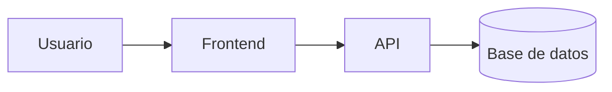
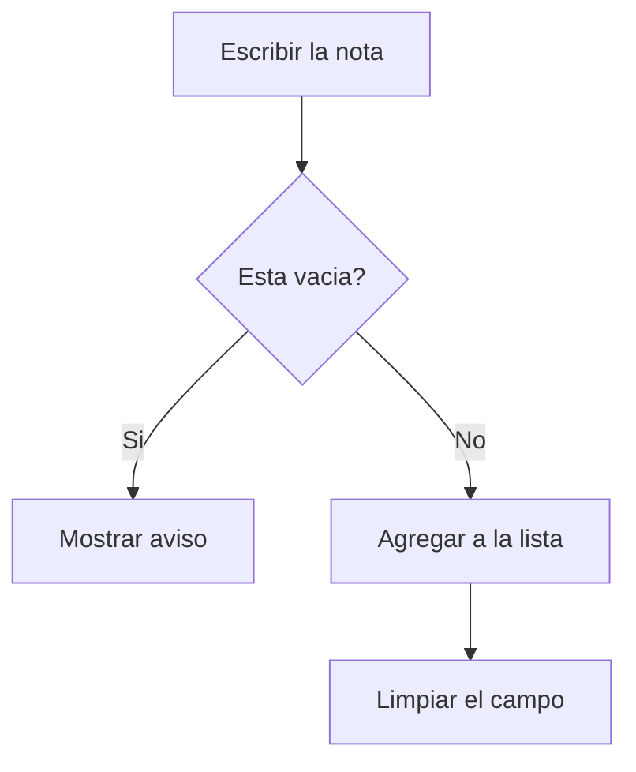

# App Notas


Aplicacion web sencilla para guardar notas desde el navegador.

## Estado de las funciones
| Funcion | Estado | Prioridad |
|:---|:---:|---:|
| Agregar nota | Listo | Alta |
| Eliminar nota | En curso | Media |
| Guardar en el navegador | Pendiente | Baja |

## Hoja de ruta
- [x] Diseno de la pantalla
- [x] Agregar notas a la lista
- [ ] Eliminar notas
- [ ] Guardar con localStorage

## Ejemplos de codigo

Estructura del formulario:
```html
<input id="nota" placeholder="Escribe una nota">
<button onclick="agregar()">Agregar</button>
```
```js
function agregar() {
  const texto = document.getElementById("nota").value;
  console.log("Nota agregada:", texto);
}
```
```json
{
  "id": 1,
  "texto": "Estudiar Markdown",
  "hecha": false
}
```
## Arquitectura


## Instalacion y Uso

1. Clona el repositorio:
   ```bash
   git clone https://github.com/favioet23-design/app-notas.git
